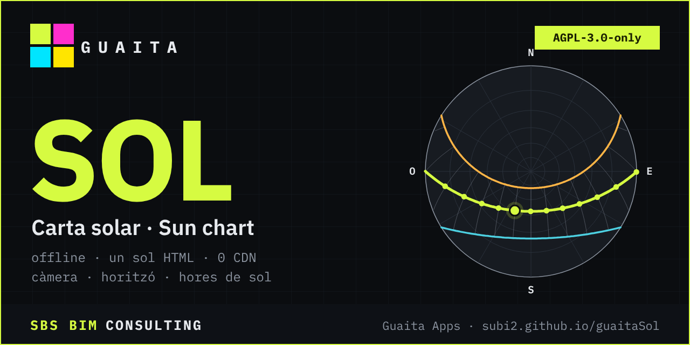

<!-- SPDX-License-Identifier: AGPL-3.0-only · Copyright (c) 2026 SBS BiM Consulting, Jordi Subirós -->

<b>🇨🇦 <a href="#català">Català</a></b> · <b>🇬🇧 <a href="#english">English</a></b>

---

## Català

**guaitaSOL** calcula on és el Sol en qualsevol lloc, dia i hora i ho mostra en una **carta solar**, sobre la **càmera**, amb un **perfil d'horitzó** i en **hores de sol directe**. És **un sol fitxer HTML** per a mòbil i tauleta: no es connecta a cap servidor i funciona sense Internet. Forma part de la suite **Guaita Apps**.

- 🌐 Web: <https://subi2.github.io/guaitaSol/>
- ▶ App (català): <https://subi2.github.io/guaitaSol/pagescat/index.html> · Manual: [HLP](pagescat/HLP_guaitaSOL-ajuda.html) · [README_AJUDA.md](README_AJUDA.md)

### Instal·la-la com a aplicació (PWA)

- **Android (Chrome):** menú ⋮ → «Instal·la l'aplicació».
- **iPhone / iPad (Safari):** Comparteix → «Afegeix a la pantalla d'inici».
- **Ordinador (Chrome, Edge):** icona d'instal·lar a la barra d'adreces.
- Cal servir-la per HTTPS (GitHub Pages); en obrir el fitxer en local (`file://`) funciona com a pàgina normal, sense PWA ni càmera.

### Funcions

| | |
|---|---|
| ☀ **Carta solar** | Projecció estereogràfica, equidistant o cilíndrica; hora solar o oficial; solsticis i equinocci; analemes |
| 📷 **Càmera i sensors** | Trajectòries sobre la imatge, brúixola (iOS i Android), calibratge amb el Sol, simulador d'orientació |
| ⛰ **Perfil d'horitzó** | Punts per càmera, tocant el gràfic o a mà; importació i exportació JSON/CSV |
| 🕒 **Hores de sol directe** | Dia, pèrdua per obstacles, mapa anual, mitjana mensual i CSV |
| 🔒 **Privadesa** | Cap CDN, cap servidor, `connect-src 'none'`; dades només al dispositiu |

### Fitxers

| Fitxer · File | |
|---|---|
| `index.html` | Landing bilingüe · bilingual landing |
| `pagescat/index.html` | **L'app (català)** · single-file app, Catalan |
| `pagescat/HLP_guaitaSOL-ajuda.html` | Manual d'ús (CA) |
| `pageseng/index.html` | **The app (English)** |
| `pageseng/HLP_guaitaSOL-help_EN.html` | User guide (EN) |
| `*/manifest.webmanifest` · `*/sw.js` · `*/icon-*.png` | Fitxers PWA, sempre a la mateixa carpeta que l'app · PWA files, always next to the app |
| `README_AJUDA.md` · `README_HELP.md` | Manual en Markdown · Markdown manual |
| `NOTICE.md` · `CLA.md` · `LICENSE` | Autoria, tercers, contribuïdors, llicència |
| `guaitaSOL_social_preview.png` · `guaitaSOL_social_square.png` · `banner.svg` · `poster_*.jpg` | Imatges de marca · brand images |

### Ús

Obre `pagescat/index.html` des de GitHub Pages. Tria el lloc (GPS o manual), mou el dia i l'hora, i canvia de vista amb les pestanyes. Dreceres: `←` `→` dia, `Espai` animar, `N` ara, `L` lloc, `M` marcar, `Z` desfer, `F1` ajuda.

### Limitacions conegudes

- Els sensors dels mòbils tenen errors típics de 5° a 10°: calibra amb el Sol.
- Els resultats són geomètrics: no tenen en compte els núvols.
- La càmera, la brúixola i el GPS requereixen HTTPS i permís de l'usuari.

---

## English

**guaitaSOL** computes where the Sun is at any place, date and time and shows it as a **sun chart**, over the **camera**, with a **horizon profile** and as **direct sun hours**. It is a **single HTML file** for phone and tablet: it connects to no server and works offline. Part of the **Guaita Apps** suite.

- 🌐 Web: <https://subi2.github.io/guaitaSol/>
- ▶ App (English): <https://subi2.github.io/guaitaSol/pageseng/index.html> · Guide: [HLP](pageseng/HLP_guaitaSOL-help_EN.html) · [README_HELP.md](README_HELP.md)

### Install it as an app (PWA)

- **Android (Chrome):** ⋮ menu → “Install app”.
- **iPhone / iPad (Safari):** Share → “Add to Home Screen”.
- **Desktop (Chrome, Edge):** install icon in the address bar.
- It must be served over HTTPS (GitHub Pages); opened locally (`file://`) it is a normal page, with no PWA or camera.

### Features

| | |
|---|---|
| ☀ **Sun chart** | Stereographic, equidistant or cylindrical projection; solar or clock time; solstices and equinox; analemmas |
| 📷 **Camera and sensors** | Paths over the live image, compass (iOS and Android), Sun calibration, orientation simulator |
| ⛰ **Horizon profile** | Points by camera, by tapping the chart or by hand; JSON/CSV import and export |
| 🕒 **Direct sun hours** | Day, loss from obstacles, yearly map, monthly average and CSV |
| 🔒 **Privacy** | No CDN, no server, `connect-src 'none'`; data stays on the device |

### Files

See the table in the Catalan section: PWA files and sibling files must sit in the same folder as the app.

### Usage

Open `pageseng/index.html` from GitHub Pages. Choose the place (GPS or manual), move the day and time, and switch views with the tabs. Shortcuts: `←` `→` day, `Space` animate, `N` now, `L` place, `M` mark, `Z` undo, `F1` help.

### Known limitations

- Phone sensors typically err by 5° to 10°: calibrate with the Sun.
- Results are geometric: clouds are not considered.
- Camera, compass and GPS need HTTPS and the user's permission.

---

### Contribuir · Contributing

Les contribucions requereixen acceptar el [CLA](CLA.md) (`Signed-off-by` a cada commit). · Contributions require accepting the [CLA](CLA.md) (`Signed-off-by` on every commit).

### Components de tercers · Third-party components

Vegeu / see [NOTICE.md](NOTICE.md). IBM Plex (SIL OFL 1.1) incrustada.

SBS BIM Consulting 2026 · Copyright © 2026 Jordi Subirós · `SPDX-License-Identifier: AGPL-3.0-only`

> Guaita Apps es distribueix «tal com és», sense cap garantia. Les eines estan pensades desde la recerca i com a suport tècnic i educatiu; la verificació dels resultats i la responsabilitat derivada del seu ús recauen únicament sobre l'usuari final.
>
> Guaita Apps is distributed “as is”, without any warranty. The tools are designed from research and as technical and educational support; verification of the results and the responsibility arising from their use rest solely with the end user.
