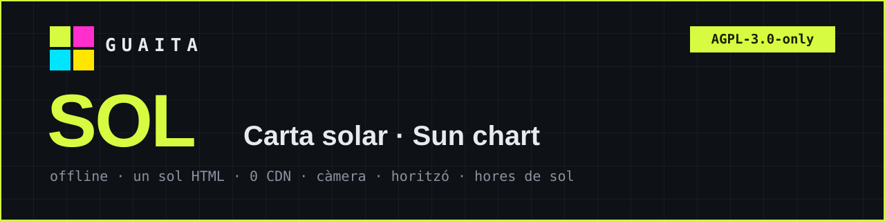

<!-- SPDX-License-Identifier: AGPL-3.0-only · Copyright (c) 2026 SBS BiM Consulting, Jordi Subirós -->

# guaitaSOL · Català

Aplicació i manual en català. Els fitxers PWA (`manifest.webmanifest`, `sw.js`, icones) han de ser sempre a la mateixa carpeta que `index.html`.

- `index.html` · L'app guaitaSOL en català
- `HLP_guaitaSOL-ajuda.html`
- `manifest.webmanifest` · `sw.js` · `icon-192.png` · `icon-512.png` · `icon-512-maskable.png`

[← README](../README.md)
